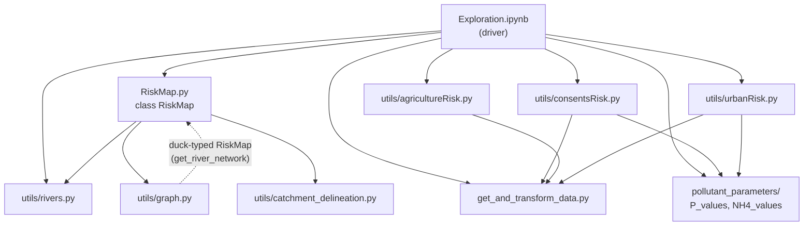
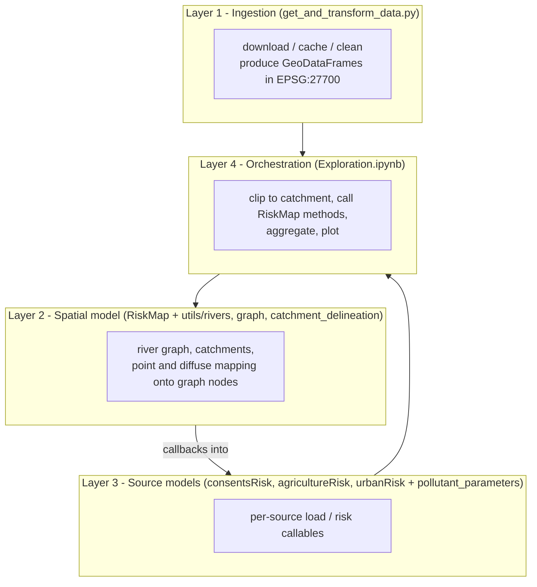

# 1. Architecture

## 1.1 Repository layout and responsibilities

| Path | Responsibility |
|---|---|
| [get_and_transform_data.py](../../get_and_transform_data.py) | Download, clean, cache and load all external datasets (CSO, consents, rivers, OS data, CROME, soil, rainfall). |
| [RiskMap.py](../../RiskMap.py) | The `RiskMap` class: owns the river graph, catchments, and computed risk values. The central orchestrator. |
| [utils/rivers.py](../../utils/rivers.py) | River geometry helpers: split lines into segments, build the directed graph, snap points to the nearest river, linear flow model. |
| [utils/graph.py](../../utils/graph.py) | Graph algorithms: bounded BFS that tags nodes with source distances; point-risk and diffuse-risk calculations over the graph. |
| [utils/catchment_delineation.py](../../utils/catchment_delineation.py) | DEM download + WhiteboxTools watershed delineation. |
| [utils/consentsRisk.py](../../utils/consentsRisk.py) | WwTW and CSO inputs (consent values, fill values) and per-source risk functions. |
| [utils/agricultureRisk.py](../../utils/agricultureRisk.py) | Crop/land-cover and livestock diffuse load functions. |
| [utils/urbanRisk.py](../../utils/urbanRisk.py) | Road and building diffuse load functions. |
| [pollutant_parameters/P_values.py](../../pollutant_parameters/P_values.py), [NH4_values.py](../../pollutant_parameters/NH4_values.py) | Pollutant constants (guideline, degradation, fill values, runoff EMCs) and the `*_distance_scaling` decay functions. |
| [data/](../../data) | Small committed lookup tables and `soil_host_data.zip`; everything else here is downloaded/generated and git-ignored. |
| [Exploration.ipynb](../../Exploration.ipynb) | The de-facto "main program": wires everything together for one catchment and plots results. |

`requirements.txt` is referenced by the README but is not present in the repository.

## 1.2 Module dependency graph

Notes on the dependencies:

- `RiskMap` does **not** import the risk-source modules. The notebook passes them in as callables (`load_method`, `risk_method`, `distance_scaling`), so `RiskMap` is source-agnostic.
- `utils/graph.add_point_risk` receives the `RiskMap` instance and calls `get_river_network(copy=False)` on it (duck-typed, no import).
- The three risk-source modules import `get_and_transform_data` directly and do real work at import time (see [06-refactoring-notes.md](./06-refactoring-notes.md#module-import-side-effects)).

## 1.3 Layers

## 1.4 Entry points

| Entry point | Purpose |
|---|---|
| `python get_and_transform_data.py` | Forces a full re-download and re-transform (`get_and_transform_data(True)` then `get_OS_data(True)`). Errors are logged at CRITICAL and swallowed. |
| `Exploration.ipynb` | Runs the full model for one catchment (default: Browney, operational catchment 3052). |
| Programmatic: `RiskMap.RiskMap(...)` | Public API used by the notebook (see [03-riskmap-pipeline.md](./03-riskmap-pipeline.md#33-the-riskmap-class)). |

## 1.5 External dependencies

**Python libraries** (inferred from imports): `geopandas`, `pandas`, `numpy`, `shapely`, `networkx`, `momepy` (graph from GeoDataFrame and back), `fiona`, `requests`, `fuzzywuzzy`, `OSGridConverter`, `elevatr` (DEM tiles), `whitebox_workflows` (hydrology), `typing_extensions`, plus `pyarrow` for parquet and an Excel reader for `pd.read_excel`.

**External programs**: `mdb-export` (mdbtools) - invoked via `subprocess` to read the Access consents database.

**Network services used at runtime**

| Service | Used by | When | Cached? |
|---|---|---|---|
| EA Storm Overflow Annual Return (zip/xlsx) | `get_cso_annual_data` | first run / `repeat` | yes (`data/annual/`, parquet) |
| EA Consents database (zip/accdb) | `get_consents_data` | first run / `repeat` | yes (`data/consentsdb/`) |
| Open Rivers Network GeoPackage | `get_rivers_data` | first run / `repeat` | yes (`data/rivers.parquet`) |
| OS Built Up Areas, OS OpenMap Local | `get_OS_data` | first run / `repeat` | yes (parquet) |
| CROME 2023 (EA OGC API features) | `get_crome_data` | each `get_land_cover_data` call | **no** (in-memory module cache only) |
| Met Office annual rainfall (ArcGIS GeoJSON) | `get_rainfall_data` | at import of `urbanRisk`, and each land-cover build | **no** |
| EA WFD operational catchments shapefile | `agricultureRisk` | at import | **no** |
| Elevation tiles (`elevatr`, zoom 12) | `catchment_delineation` | per delineation | yes (`data/tiles/`) |

## 1.6 Runtime state

State lives in three places:

1. **On disk** under `data/` (parquet caches, WhiteboxTools working files in `data/wbe/`, DEM tiles in `data/tiles/`).
2. **Inside the `RiskMap` instance**: river GeoDataFrames, the `networkx.DiGraph` whose node attributes accumulate every load and risk, and the catchment tables.
3. **Module-level globals** that act as caches:

| Module | Globals | Purpose |
|---|---|---|
| `utils/catchment_delineation.py` | `rmap_before` | Skip re-delineation if the risk map geometry is unchanged; re-read `data/wbe/polygons.shp` instead. |
| `utils/agricultureRisk.py` | `land_cover_data`, `catchments_used` | Reuse the combined crop/soil/rain layer while catchments are unchanged. |
| `utils/urbanRisk.py` | `joined_catchments_before`, `combined_roads`, `combined_builds` | Reuse overlay results while catchments are unchanged. |
| `utils/consentsRisk.py` | `wwtw_join`, `cso_join`, `determinands` | Module-level DataFrames built at import and read by the risk callables. |
| `utils/agricultureRisk.py` | `AGRICULTURE_LOAD_LOOKUP`, `LIVESTOCK_EXCRETA`, `ENG_CATCH`, `EXCRETA_LOAD` | Lookup tables loaded at import. |
