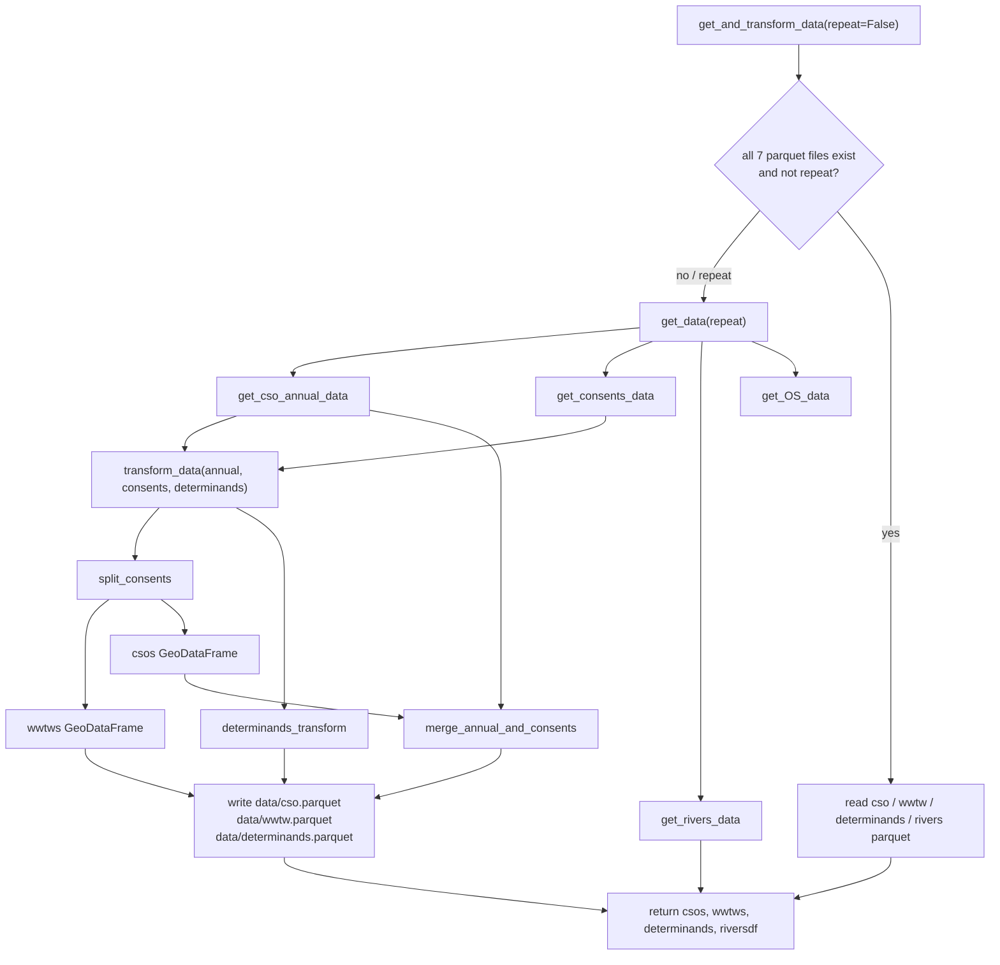
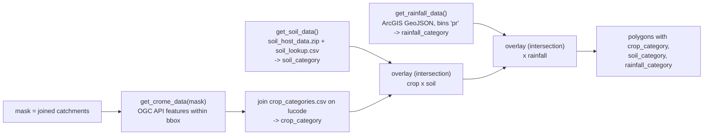

# 2. Data Ingestion (`get_and_transform_data.py`)

This module downloads raw datasets, converts them to GeoDataFrames in EPSG:27700, caches them as parquet under `data/`, and exposes loader functions used by the notebook and the risk modules.

## 2.1 Top-level flow



The "all files exist" check covers `cso`, `wwtw`, `determinands`, `rivers`, `os_roads`, `os_buildings` and `os_builtup` parquet files in `data/`. If any is missing, the whole download/transform/save path runs (each `get_*` function still honours its own cache first).

Return value: `(csos, wwtws, determinands, riversdf)`.

## 2.2 Individual loaders

### `get_cso_annual_data(repeat)` -> CSO annual returns
1. If `data/annual/cso.parquet` exists (and not `repeat`), return it.
2. Download `EDM_2024_Storm_Overflow_Annual_Return.zip` from the EA, extract to `data/annual/`.
3. Read **every sheet** of the Excel workbook (one per water company, `header=1`) and concatenate.
4. Take the outlet NGR column (`Outlet Discharge NGR (EA Consents Database)`), keep the first token (split on space then comma), and convert with `get_lat_lon` (`OSGridConverter.grid2latlong` -> `shapely.Point(lon, lat)`; failures logged, `None` returned).
5. Build a GeoDataFrame in EPSG:4326, reproject to 27700, strip whitespace from all string columns, write `data/annual/cso.parquet`.

### `get_consents_data(repeat)` -> `(consents, determinands)` DataFrames
1. If `data/consentsdb/consents.csv` and `determinands.csv` exist, read and return them.
2. Otherwise download the zipped Access database (`.accdb`) unless already extracted.
3. Run `mdb-export <accdb> determinands` and `mdb-export <accdb> consents_active` to write the two CSVs, then read them.

### `get_rivers_data(repeat)` -> rivers GeoDataFrame
1. If `data/rivers.parquet` exists, return it.
2. Download the Open Rivers Network GeoPackage zip (browser-style `User-Agent`; on failure retry once with `verify=False`).
3. Read layer `ORN` from the in-memory bytes via `fiona.BytesCollection`, reproject to 27700, save `data/rivers.parquet`.

### `get_OS_data(repeat)` -> writes files only
Returns nothing; writes three parquet files then deletes the temporary downloads:

| Output | Source | Content |
|---|---|---|
| `data/os_builtup.parquet` | OS Built Up Areas GeoPackage | geometry only |
| `data/os_roads.parquet` | OS OpenMap Local, layer `road` | all columns, with bbox covering for spatial filtering |
| `data/os_buildings.parquet` | OS OpenMap Local, layer `building` | geometry only, with bbox covering |

The parquet files are later read with a `bbox=` filter so only the area of interest is loaded.

## 2.3 Transformations

### `split_consents(consents)` -> `(wwtws, csos)`

```text
wwtws = rows where
      (DISCHARGE_SITE_TYPE_CODE == "A2" AND EFFLUENT_TYPE == "SA" AND OUTLET_TYPE_CODE in {"S","U"})
   OR (DISCHARGE_SITE_TYPE_CODE in {"A0","A1"} AND RECEIVING_ENVIRON_TYPE_CODE in {1, 6, 9, 15})

csos  = rows where EFFLUENT_TYPE in {"SB","SC","SD"}
```

Operator precedence matters: the receiving-environment filter applies only to the private works (`A0`/`A1`), not to water-company works (`A2`). Both subsets then go through `consents_transform`.

### `consents_transform(df)` -> GeoDataFrame
1. Drop duplicates on `(PERMIT_NUMBER, OUTLET_GRID_REF)`, keeping the first.
2. Create `ID = PERMIT_NUMBER_EFFLUENT_NUMBER_OUTLET_NUMBER` and make it the index.
3. Convert `OUTLET_GRID_REF` to a point with `get_lat_lon` (EPSG:4326), reproject to 27700.

### `determinands_transform(determinands)` -> DataFrame
1. Keep only these determinand codes (`DETE_CODE`): 7782 (DWF), 7729 (DWF 3-in-5-years), 135 (suspended solids), 85 (BOD), 111 (ammoniacal N), 6051 (iron), 348 (total P), 6057 (aluminium), 3647 (flow to full treatment), 8174 (weir setting), 6425 (daily total flow).
2. Each row carries up to three `(CODE_i, VAL_i)` pairs. Combine them into a list of tuples and `explode`, producing one row per `(CODE, VALUE)` where `CODE` is a label such as `MEAN VALUE`, `MAXIMUM VALUE`, `MINIMUM VALUE`.
3. Keep only the highest `VERSION` for each `(PERMIT_REF, OUTLET_NUMBER, EFFLUENT_NUMBER, DETE, CODE)`.
4. Re-index by the string `PERMIT_REF_EFFLUENT_NUMBER_OUTLET_NUMBER`, which matches the `ID` index of the consents tables.

### `merge_annual_and_consents(annual, csos)` -> CSO GeoDataFrame
Links each annual-return row (location + spill statistics) to a consents row (permit metadata). The consents key (`ID`) is needed later to look up the weir setting.

1. Buffer each annual CSO point by **5000 m** and spatially join (`contains`) the consent outlet points.
2. Fuzzy-match (`fuzzywuzzy.fuzz.ratio`) the permit reference in the annual data (`EA Permit Reference` and `WaSC Supplementary Permit Ref.`) against the consent `PERMIT_NUMBER`; keep the higher of the two scores.
3. Rows with score `<= 92` get `ID = NaN` (no usable match).
4. Per `Unique ID` keep the max-score row(s), drop NaN-`ID` duplicates, then keep the row with the smallest distance between annual point and consent outlet.
5. Rename `Total Duration (hh:mm:ss) all spills prior to processing through 12-24h count method` to `SpillDuration`, drop helper columns, index by `Unique ID`.

Result: the CSO table in `data/cso.parquet`, indexed by `Unique ID`, with an `ID` column (the consent key, possibly NaN) and `SpillDuration`.

## 2.4 Land-cover loaders (used by the diffuse models, not cached on disk)

`get_land_cover_data(mask)` builds the combined polygon layer used for agriculture:



| Function | Detail |
|---|---|
| `get_crome_data(mask)` | Builds a WGS84 bbox from the mask (padded by 0.0005 deg), reads CROME 2023 features directly via `gpd.read_file` on the OGC API URL, masks to the polygon, reprojects to the mask CRS. Left-joins `crop_categories.csv` (`code` -> `crop_category`) after dropping lookup rows whose `category` is `"N/A"`, so those land-use codes end up with a NaN `crop_category`. |
| `get_soil_data()` | Reads `data/soil_host_data.zip`, keeps `HOST` + geometry, reprojects, left-joins `soil_lookup.csv` (`HOST` -> `soil_category`). |
| `get_rainfall_data()` | Reads the annual precipitation GeoJSON (1991-2020 observations) from ArcGIS, reprojects, bins `pr` (mm/yr) into `rainfall_category`: `>1500`=5, `>1200`=4, `>900`=3, `>700`=2, `>600`=1, else 0. |

`get_rainfall_data()` is also used directly by `urbanRisk` (it needs `pr` as annual rainfall in mm).

## 2.5 Files produced under `data/`

See [05-data-reference.md](./05-data-reference.md#51-files-under-data) for the full list of files, git status and schemas.
