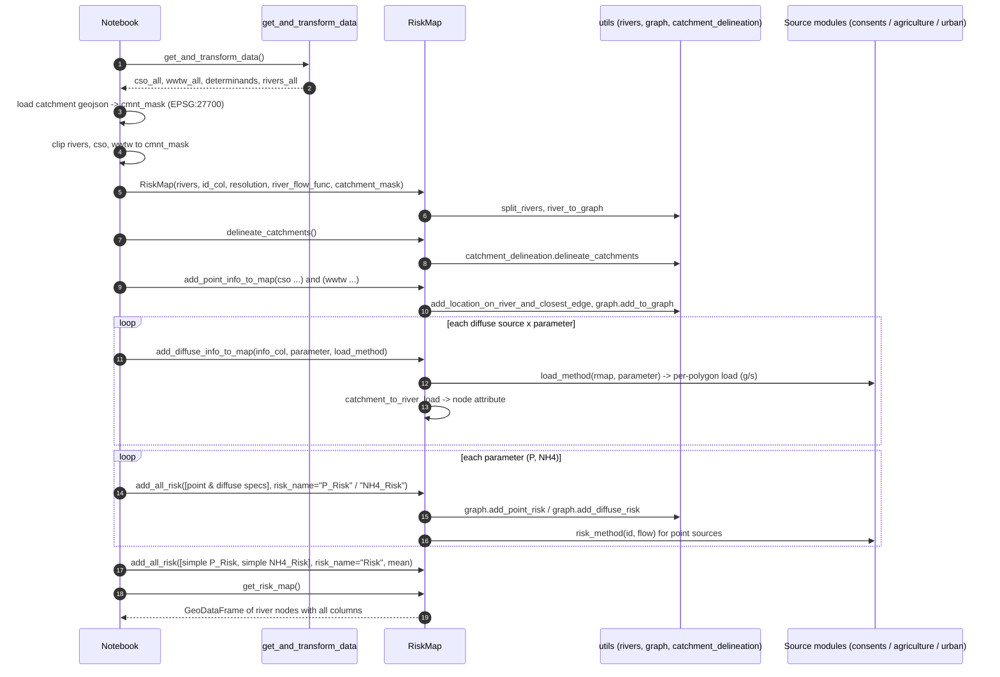
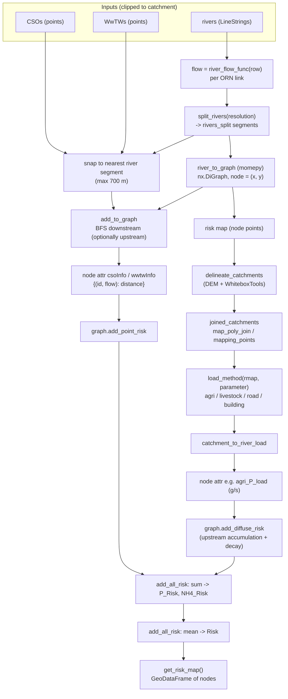
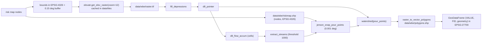
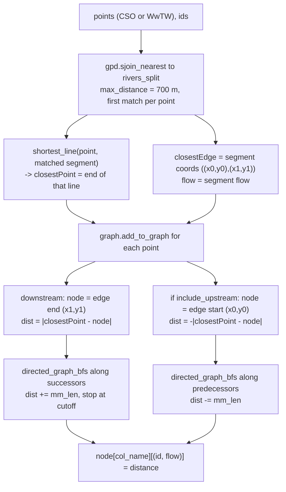
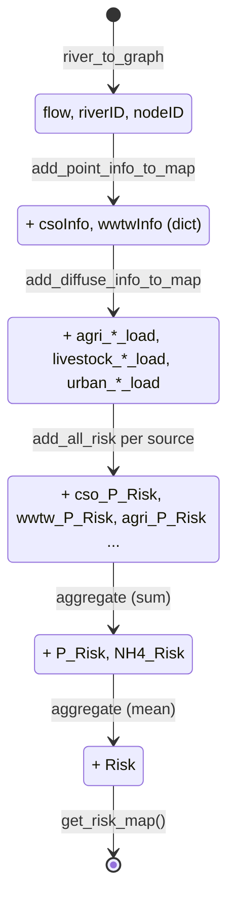

# 3. The Risk Map Pipeline

This document traces a complete run, from raw data to the final `Risk` column, and explains each stage of the `RiskMap` class and its helpers.

## 3.1 End-to-end sequence (as driven by `Exploration.ipynb`)



The notebook parameters: `RIVER_RESOLUTION = 300` m, `MAX_OUTFALL_DIST_FROM_RIVER = 700` m, `MAX_RISK_DISTANCE = inf`, river id column `RivID`, and flow function `linear_flow(row["US_Accum"])`.

## 3.2 Data-flow summary



## 3.3 The `RiskMap` class

All work is in EPSG:27700. Constructor signature:

```python
RiskMap(riversdf, id_col, resolution, river_flow_func, catchment_mask=None)
```

### Construction (`__init__`)
1. Validate `id_col`; reproject to 27700; rename `id_col` to `riverID`.
2. `rivers["flow"] = riversdf.apply(river_flow_func, axis=1)` (flow in m³/s per link).
3. `rivers_split = utils.rivers.split_rivers(rivers, resolution)`.
4. `rivers.set_index("riverID")` (the unsplit copy, now indexed by river id).
5. `construct_river_graph()` builds the DiGraph from `rivers_split`.
6. `__construct_risk_map()` converts graph nodes to a GeoDataFrame.
7. Initialise catchment fields to `None` and store `catchment_mask`.

### Key attributes (private, name-mangled `_RiskMap__*`)

| Attribute | Type | Meaning |
|---|---|---|
| `__rivers` | GeoDataFrame | Original links, indexed by `riverID`, with `flow`. |
| `__rivers_split` | GeoDataFrame | Segments of length ~`resolution`; columns `riverID`, `flow`, `geometry`. |
| `__river_network` | `nx.DiGraph` | The model. All computed values are stored as **node attributes**. |
| `__risk_map` | GeoDataFrame | Node points rebuilt from the graph on demand (a snapshot, not the source of truth). |
| `__joined_catchments` | GeoDataFrame | Merged catchment polygons, indexed by `FID_poly`, geometry column named `poly`. |
| `__map_poly_join` | DataFrame | `FID_poly`, `FID_to_join`, `river_index`: which small polygons merge into which. |
| `__mapping_points` | DataFrame | Per node: `river_index`, `geometry`, original `FID`, `poly`. |
| `__catchment_mask` | GeoDataFrame or None | Optional clip for delineated polygons. |

### Public methods

| Method | Role |
|---|---|
| `get_rivers`, `get_rivers_split`, `get_river_network`, `get_risk_map`, `get_joined_catchments` | Accessors (copies by default). `get_risk_map` rebuilds the snapshot every call; `get_joined_catchments` triggers delineation if not yet done. |
| `delineate_catchments(min_area=20000)` | Builds catchments and merge tables (3.5). |
| `add_point_info_to_map(ids, geometry, col_name_graph, max_risk_distance, max_dist_from_river, include_upstream=False)` | Maps point sources to the graph (3.6). Returns the snapped outfall points. |
| `add_diffuse_info_to_map(info_col_name, parameter, load_method)` | Maps a catchment load to graph nodes (3.7). |
| `add_point_risk(...)`, `add_diffuse_risk(...)`, `add_simple(...)` | Compute one risk layer and store it as a node attribute (or return it when `inplace=False`). |
| `add_risk(type, **kwargs)` | Dispatch to the three above by `type` in `{"point", "diffuse", "simple"}`. |
| `add_all_risk(risk_list, aggregation_method=sum, risk_name="Risk", inplace=True)` | Runs each spec in `risk_list`, then aggregates the per-spec node values into a single node attribute `risk_name`. |
| `catchment_to_river_load(load)` | Converts per-polygon load to per-node load (3.7). |

## 3.4 River graph construction

`utils/rivers.py`:

1. **`split_rivers`**: reject non-(Multi)LineStrings; `explode` MultiLineStrings; for each line, interpolate points every `resolution` metres (`np.arange(0, length, resolution)`), append the true endpoint if missing, and emit `LineString([p1, p2])` for consecutive points. Result columns: `riverID`, `flow`, `geometry`, with a fresh 0..n-1 index.
2. **`river_to_graph`**: `momepy.gdf_to_nx(rivers_split, approach="primal", directed=True, multigraph=False)`.
   - Nodes are line endpoints, keyed by `(x, y)` tuples; edge direction follows the line digitisation direction (assumed downstream).
   - Edge attributes include `riverID`, `flow` and momepy's `mm_len` (edge length in m).
   - Node attribute `flow` = max `flow` over incident edges; node attribute `riverID` = set of incident river ids.
3. **`__graph_to_gdf`**: `momepy.nx_to_gdf(graph, points=True, lines=False)`, drop `x`, `y`, `nodeID`, and normalise dict/set cells to lists. The row index of this GeoDataFrame is the node's `nodeID`, which is the identifier used by catchment mapping.

River flow model: `linear_flow(accum_len) = 1.476e-5 * accum_len` where `accum_len` is the ORN `US_Accum` (upstream accumulated length, m).

## 3.5 Catchment delineation

Purpose: assign each river node an upstream catchment polygon so area-based loads can be attributed to the river.

### Step A: hydrology (`utils/catchment_delineation.delineate_catchments`)



Every river node is a pour point, so there is one watershed per node. `VALUE` is the 1-based pour-point order. A module-level cache (`rmap_before`) returns the stored `polygons.shp` when the same risk map is passed again.

### Step B: merging small catchments (`RiskMap.delineate_catchments`)
1. `make_valid` the polygons; if a `catchment_mask` exists, intersect the polygons with it.
2. `value2 = VALUE - 1` aligns polygons to risk-map rows. Left-join risk-map nodes with their polygon -> `mapping_points` (`river_index`, `geometry`, `FID`, `poly`). A node with no polygon gets an empty polygon.
3. `include = polygon area > min_area` (default 20 000 m², i.e. 2 ha).
4. Starting at **outlet nodes** (no successors) and walking **upstream** level by level (BFS over predecessors):
   - an included predecessor keeps its own polygon: row `(FID_poly=p_fid, FID_to_join=p_fid, river_index=p)`;
   - a non-included predecessor adopts the downstream node's `FID` (so the merge chains through several small nodes) and is recorded as `(FID_poly=c_fid, FID_to_join=p_fid, river_index=p)`.
5. Drop rows with `FID_to_join` NaN, attach each `FID_to_join` polygon, make valid, group by `FID_poly` and `union_all` the polygons -> `joined_catchments`.

Outputs stored on the instance: `__joined_catchments` (indexed by `FID_poly`, geometry column `poly`), `__map_poly_join`, `__mapping_points`.

## 3.6 Point sources onto the graph (`add_point_info_to_map`)



- The node attribute is a dict `{(source_id, river_flow_at_source): distance_m}`. Upstream nodes get negative distances; the decay functions return 0 for negative distance.
- Points with no river within `max_dist_from_river` are skipped.
- The BFS skips a node if the source `id` is already recorded there.
- Returns the `closestPoint` series; the notebook stores it as `outfallLocation` for plotting.

## 3.7 Diffuse sources onto the graph (`add_diffuse_info_to_map`)

1. Ensure catchments are delineated.
2. `catchment_load = load_method(self, parameter)`: a GeoDataFrame that **must** have `FID_poly` and `load` (g/s) columns, one row per sub-polygon.
3. `catchment_to_river_load(load)`:
   - `groupby("FID_poly").sum()` of `load`;
   - join to `map_poly_join[["river_index", "FID_poly"]]` (1 catchment : many nodes);
   - divide each catchment's load **equally** among the nodes mapped to it (`load / count`);
   - result: Series indexed by node id (`river_index`).
4. For every graph node, set `node[info_col_name]` = that node's share, or `0` if it has none; rebuild the risk map snapshot.

## 3.8 Computing risk (`add_all_risk`)

`add_all_risk(risk_list, aggregation_method, risk_name)` loops over specs (dicts of `add_risk` keyword arguments), runs each, then for every node sets `node[risk_name] = aggregation_method([node[spec.risk_name] for spec in risk_list])`.

Per-spec types:

| `type` | Calls | Reads node attribute | Writes node attribute |
|---|---|---|---|
| `"point"` | `graph.add_point_risk` | dict `{(id, flow): dist}` | `risk_name` |
| `"diffuse"` | `graph.add_diffuse_risk` | numeric load (g/s) | `risk_name` and a hidden `<info_col>_cum` on a graph *copy* only |
| `"simple"` | no-op when in place | an existing node attribute named `risk_name` | (aggregated by the parent call) |

The notebook calls `add_all_risk` three times:
1. `risk_name="P_Risk"`: sum of `cso_P_Risk`, `wwtw_P_Risk`, `agri_P_Risk`, `livestock_P_Risk`, `urban_road_P_Risk`, `urban_build_P_Risk`.
2. `risk_name="NH4_Risk"`: same six sources for NH4.
3. `risk_name="Risk"`: `np.mean` of the `simple` entries `P_Risk` and `NH4_Risk`.

Formulas are in [04-risk-calculations.md](./04-risk-calculations.md).

## 3.9 Lifecycle of a graph node's attributes


