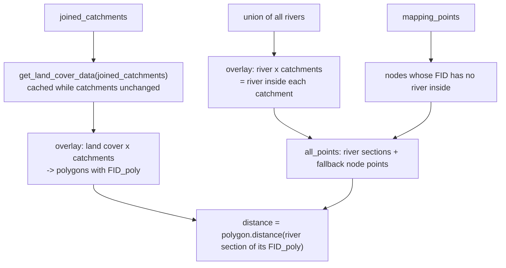

# 4. Risk Calculations

This document describes every numeric computation, with units, in the order data flows through it. For the scientific justification see [../docs.md](../docs.md).

## 4.1 Common definitions

| Symbol | Meaning | Source |
|---|---|---|
| `Q` | River flow (m³/s) | `linear_flow(US_Accum) = 1.476e-5 * US_Accum`; node flow = max over incident edges |
| `G` | Guideline concentration (mg/l) | `P_GUIDELINE = 0.87`, `NH4_GUIDELINE = 6.0` |
| `k` | Degradation coefficient (/day) | `P_DEGRADATION_COEFF = 0.04`, `NH4_DEGRADATION_COEFF = 0.42` |
| `v` | Flow speed (m/s) | `FLOW_SPEED = 0.77` (both pollutants) |

**Distance decay** (`p_distance_scaling`, `nh4_distance_scaling`), `x` in metres along the river:

```text
decay(x) = 0                              if x < 0
         = exp( -(k / 86400) * x / v )    otherwise
```

(`x / v` is travel time in seconds, `k / 86400` converts /day to /s.) The functions accept scalars or arrays.

**Risk scale**: for each source the "risk" is the in-river concentration it contributes, divided by the guideline, times 100. A value of 100 means that source alone would bring the river to the guideline value. Source risks are summed, so totals can exceed 100.

```text
risk = concentration_mg_per_l / G * 100
```

## 4.2 Point sources

Computed by `graph.add_point_risk`, which calls a per-source `risk_method(id, river_flow)`.

### Aggregation over sources at a node

For node `n` with attribute `{(id_i, Q_i): d_i}` (`Q_i` = flow at the source's snapped segment, `d_i` = distance from the source to `n`):

```text
r_i = risk_method(id_i, Q_i) * decay(d_i)         (sources with r_i == 0 are skipped)
```

| `aggregation_method` | Result at node |
|---|---|
| `"sum"` | `sum(r_i)` |
| `"avg"` | `mean(r_i)`, or 0 if none |
| `"flow_avg"` (default, used by the notebook) | `sum(Q_i * r_i) / Q_n`, where `Q_n` is the node's flow |

`ids_to_ignore` can exclude sources by id. A `ValueError` is raised if `info_col` exists on no node.

### WwTW (`consentsRisk.add_wwtw_risk(parameter)`)

Inputs per works, from `wwtw_join`, built at import from `wwtw.parquet` and `determinands.parquet`:

| Field | Determinand and statistic | Fill when missing |
|---|---|---|
| `P` (mg/l) | `DETE_CODE 348`, `CODE == "MEAN VALUE"`, multiplied by `0.785` (total P to orthophosphate) | `5.0` (fill is applied after the conversion, so it is not scaled) |
| `NH4` (mg/l) | `DETE_CODE 111`, `CODE == "MAXIMUM VALUE"` | `2.6` |
| `DWF` (m³/day) | `DETE_CODE 7782`, `CODE == "MAXIMUM VALUE"` | by site type: `A0` = 0.8, `A1` = 7, `A2` = 20 |

```text
concentration = C_effluent * DWF / (Q * 86400)       [mg/l]
risk          = concentration / G * 100
```

### CSO (`consentsRisk.add_cso_risk(parameter)`)

Inputs per overflow, from `cso_join` (built from `cso.parquet` + weir setting):

| Field | Value |
|---|---|
| Effluent concentration | constant: `CSO_PHOSPHORUS_FILL_VALUE = 3.0` mg/l (P), `CSO_NH4_FILL_VALUE = 13` mg/l (NH4) |
| Weir setting (l/s) | `DETE_CODE 8174`, `CODE == "MINIMUM VALUE"`, joined on consent `ID`; fill `20` l/s |
| Spill duration | `SpillDuration` (timedelta) -> seconds; NaN -> 0 |

```text
concentration = C_cso * weir_setting / (Q * 1000) * (spill_seconds / seconds_per_year)   [mg/l]
risk          = concentration / G * 100
```

The factor `spill_seconds / seconds_per_year` is the fraction of the year the overflow was spilling, so this is an annual-average contribution.

## 4.3 Diffuse sources

Each source has a **load function** `f(rmap, parameter) -> GeoDataFrame[FID_poly, load, ...]` with `load` in **g/s** per sub-polygon. [03-riskmap-pipeline.md](./03-riskmap-pipeline.md#37-diffuse-sources-onto-the-graph-add_diffuse_info_to_map) explains how this becomes a per-node load.

### Shared geometry preparation (agriculture and livestock)



`distance` is the straight-line distance from each polygon to the river (or fallback node point) of its catchment. It drives the runoff scaling below.

**Runoff scaling**: `runoff_scaling(d) = exp(-d / 100)` (0 for negative `d`). It is applied only to rows where the lookup `Pathway == 1`.

### Agriculture land cover (`agricultureRisk.agriculture_land_cover_load`)
1. Join `AGRICULTURE_LOAD_LOOKUP` (index: `crop_category`, `soil_category`, `rainfall_category`). The lookup has more than one row per key, distinguished by `Pathway` (0 and 1), so the join **duplicates each polygon once per pathway**.
2. Select `P_load` or `NH4_load` (kg/m²/yr) and convert: `x * 1000 / (365 * 86400)` -> g/m²/s.
3. For `Pathway == 1`, multiply by `runoff_scaling(distance)`.
4. Multiply by polygon area (m²) -> g/s. NaN -> 0.

### Livestock (`agricultureRisk.agriculture_livestock_load`)
1. Same overlay/distance preparation as above, then intersect with the EA WFD operational catchments (`ENG_CATCH`) to get `OPCAT_ID`.
2. Reclassify `crop_category`: grass (`4`) -> 4; rough grazing (`0`) -> 0; arable (`1,2,3,5..13`) -> -1; other values unchanged.
3. Join `LIVESTOCK_EXCRETA` on `(OPCAT_ID, crop_category)` -> `excreta_per_ha` per `livestock_category` (rows duplicated per livestock type).
4. `excreta = excreta_per_ha * area / 10000` (0 if no match).
5. Join `EXCRETA_LOAD` on `(crop_category, soil_category, rainfall_category, livestock_category)` -> `P_load` / `NH4_load` (and `Pathway`).
6. `load = excreta * X_load * 1000 / (365 * 86400)` (comment in code: kg/year -> g/s).
7. For `Pathway == 1`, multiply by `runoff_scaling(distance)`. NaN -> 0.

Note the polygon area enters through `excreta`; it is not multiplied again.

### Urban roads (`urbanRisk.urban_road`)
1. Read `os_roads.parquet` with a bbox filter, keep `geometry`, `id`, `classification`; intersect with joined catchments.
2. Join road width (m) from `road_width_lookup.csv` on `classification`.
3. Split by OS built-up areas into `urban=True` (intersection) and `urban=False` (difference).
4. Buffer rivers by `RURAL_ROAD_RIVER_DISTANCE = 200` m and split roads into `river=True` (inside) and `river=False` (outside).
5. Intersect with rainfall polygons to attach `pr` (mm/yr).
6. `area = length * width`.
7. Loads, with EMC in mg/l:

| Pollutant | Urban roads | Rural roads within 200 m of a river | Other rural roads |
|---|---|---|---|
| P | `area * 0.1 * pr` | `area * 0.1 * pr` | 0 |
| NH4 | `area * 0.8 * pr` | `area * 0.65 * pr` | 0 |

8. Convert mg/year -> g/s: `load / (1000 * 365 * 86400)`. (`area [m²] * pr [mm]` is litres of runoff.)

### Urban buildings (`urbanRisk.urban_buildings`)
Same preparation with `os_buildings.parquet` (no widths, no river buffer): intersect with catchments, split by built-up area, attach rainfall, `area = polygon area`. Only `urban=True` buildings carry load: `area * EMC * pr` with EMC `0.1` (P) or `0.2` (NH4) mg/l, same unit conversion to g/s.

### Per-node load and downstream accumulation

`RiskMap.add_diffuse_info_to_map` writes each node's load share (g/s). `graph.add_diffuse_risk` then accumulates loads down the graph in topological order:

```text
cum(n)  = load(n) + sum over predecessors p of [ cum(p) * decay(len(p -> n)) ]     [g/s]
conc(n) = cum(n) / Q_n                                                              [g/m³ = mg/l]
risk(n) = risk_method(conc(n))     with risk_method = x / G * 100 in the notebook
        = 0                         if Q_n == 0
```

`len(p -> n)` is the edge length `mm_len` (metres, one segment). The processing order is: start with all nodes without predecessors and process a node only after all its predecessors are done (`n_pred_left` counter on a graph copy). A `ValueError` is raised if no node has the `info_col` attribute.

## 4.4 Aggregation to the final score

```text
P_Risk   = cso_P_Risk + wwtw_P_Risk + agri_P_Risk + livestock_P_Risk + urban_road_P_Risk + urban_build_P_Risk
NH4_Risk = (same six sources, NH4 parameters)
Risk     = mean(P_Risk, NH4_Risk)
```

The aggregator is configurable per call (`aggregation_method`, default builtin `sum`; the notebook uses `np.mean` for the last step). The item `risk_name` `"Risk"` is reserved and rejected in the spec list.

## 4.5 Unit conversions at a glance

| Quantity | Conversion in code |
|---|---|
| kg/m²/yr -> g/m²/s (agriculture) | `* 1000 / (365 * 60 * 60 * 24)` |
| kg/yr -> g/s (livestock) | `* 1000 / (365 * 60 * 60 * 24)` |
| mg/yr -> g/s (urban) | `* 1 / (1000 * 365 * 24 * 60 * 60)` |
| WwTW flow | DWF m³/day over `Q * 86400` m³/day |
| CSO flow | weir l/s over `Q * 1000` l/s |
| Decay | `k` per day divided by `86400`, travel time `x / v` seconds |
