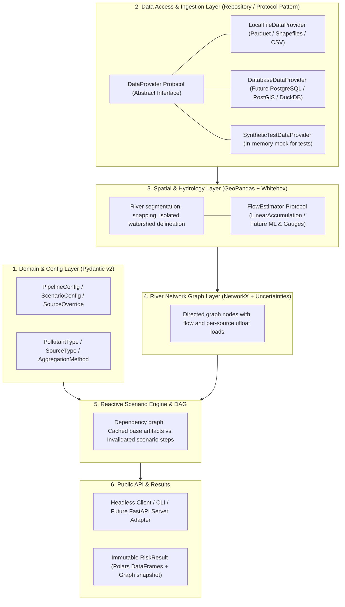
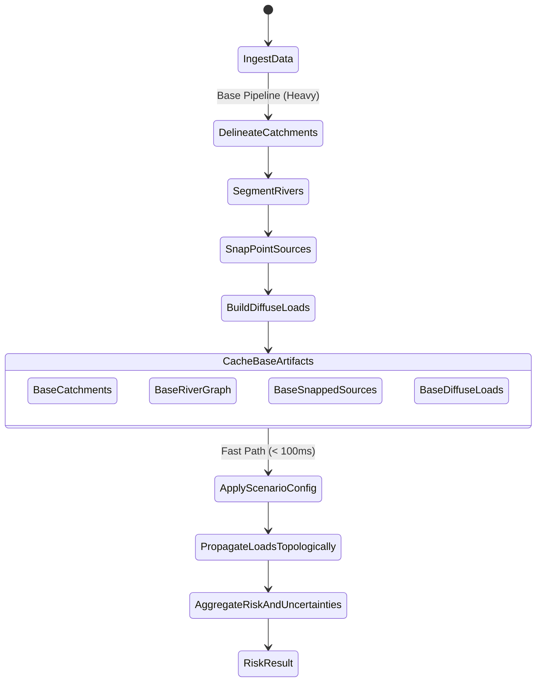

# Risk-Map Target Architecture Specification

**Status**: Proposal / Target Architecture  
**Branch**: `refactor`  
**Distribution Name**: `risk-map`  
**Package Target**: `src/risk_map/`

---

## 1. Executive Summary & Core Motivations

The `risk-map` modeling framework calculates point-source and diffuse water quality risks across river networks in the UK (EPSG:27700). The existing codebase ([RiskMap.py](RiskMap.py), [utils/](utils/)) suffers from several architectural and computational limitations:

1. **Stringly-Typed & Unsafe Interfaces**: Pollutants, sources, and aggregation methods are unvalidated strings (`"P"`, `"NH4"`, `"flow_avg"`), leading to silent logical failures and lack of autocompletion.
2. **Global Mutable State & Side Effects**: Catchment delineation writes to a fixed directory (`data/wbe`), and source modules ([utils/urbanRisk.py](utils/urbanRisk.py)) share global cache variables, preventing concurrent executions or clean server deployments.
3. **Quadratic & Redundant Graph Traversals**: Point sources are evaluated via $S$ independent Breadth-First Searches ($O(S \times V)$), causing execution times to scale poorly with number of outfalls ($S$).
4. **Physical Inconsistency Between Point and Diffuse**: Diffuse sources accumulate mass flux ($\text{g/s}$) topologically, while point sources propagate downstream concentrations through heuristic flow weighting.
5. **No Built-in Uncertainty**: All loads, flows, and degradation coefficients are deterministic point estimates with no variance or confidence tracking.
6. **No Reactive Scenario Support**: Disabling a single CSO requires re-evaluating the entire pipeline or manually hacking the NetworkX node attributes.

### Target Vision
A **typed, headless, modular, and reactive library** with:
- **Pydantic v2 + Strict Enums** for all domain models, configs, and serialization.
- **Hybrid Data Processing**: Polars for columnar lookups/joins; GeoPandas + Shapely 2 for spatial geometric predicates.
- **Unified 1D Advection-Decay Topological Sweep**: Propagates both point and diffuse loads in a single $O(V + E)$ pass while retaining **100% granular per-source attribution** at every river reach.
- **Native First-Order Error Propagation**: Integration with `uncertainties.ufloat` / `unumpy` across flows, loads, and risk ratios.
- **Reactive Scenario DAG**: Cached immutable intermediate artifacts (DEM, catchments, snapped rivers) allowing sub-second scenario evaluations (e.g. toggling a CSO outfall).

---

## 2. High-Level Architecture & Layered Design



---

## 3. Package Structure (`src/risk_map`)

```text
src/
└── risk_map/
    ├── __init__.py
    ├── config/
    │   ├── __init__.py
    │   ├── enums.py            # PollutantType, SourceType, AggregationMethod
    │   ├── models.py           # PipelineConfig, ScenarioConfig, SourceOverride
    │   └── constants.py        # Pollutant physical constants & degradation rates
    ├── data/
    │   ├── __init__.py
    │   ├── protocols.py        # DataProvider protocol (swappable repository interface)
    │   ├── local.py            # Local file-based provider (Parquet, CSV, Geopackage)
    │   ├── database.py         # Future external DB provider (PostGIS / SQL)
    │   └── synthetic.py        # Lightweight in-memory provider for fast unit tests
    ├── spatial/
    │   ├── __init__.py
    │   ├── flow.py             # FlowEstimator protocol (LinearFlowEstimator, GaugedFlowEstimator)
    │   ├── rivers.py           # Splitting and snapping (GeoPandas + Shapely 2)
    │   └── catchment.py        # Whitebox delineation with isolated scratch directories
    ├── models/
    │   ├── __init__.py
    │   ├── point_sources.py    # CSO and WwTW load calculators with uncertainties
    │   └── diffuse_sources.py  # Agriculture, livestock, urban loads with uncertainties
    ├── graph/
    │   ├── __init__.py
    │   ├── network.py          # NetworkX river graph construction
    │   └── propagation.py      # Single-pass topological sweep with source attribution
    ├── pipeline/
    │   ├── __init__.py
    │   ├── dag.py              # Lightweight dependency graph & cache manager
    │   ├── runner.py           # Headless executor
    │   └── results.py          # Immutable RiskResult object (Polars + GeoPandas)
    └── api/
        ├── __init__.py
        └── client.py           # High-level clean facade for users and notebooks
```

---

## 4. Domain Types & Strict Configuration

### 4.1 Enums (`config/enums.py`)
```python
from enum import Enum


class PollutantType(str, Enum):
    P = "P"  # Total Phosphorus / Orthophosphate
    NH4 = "NH4"  # Ammoniacal Nitrogen as N


class SourceType(str, Enum):
    CSO = "CSO"
    WWTW = "WWTW"
    AGRICULTURE = "AGRICULTURE"
    LIVESTOCK = "LIVESTOCK"
    URBAN_ROAD = "URBAN_ROAD"
    URBAN_BUILDING = "URBAN_BUILDING"


class AggregationMethod(str, Enum):
    SUM = "sum"
    MEAN = "mean"
    FLOW_WEIGHTED = "flow_weighted"
```

### 4.2 Configuration Models (`config/models.py`)
```python
from pathlib import Path
from pydantic import BaseModel, Field, PositiveFloat


class PipelineConfig(BaseModel):
    river_resolution: PositiveFloat = 300.0
    max_outfall_distance: PositiveFloat = 700.0
    min_catchment_area: PositiveFloat = 20000.0
    data_dir: Path = Field(default_factory=lambda: Path("data"))
```

### 4.3 Flow & Velocity Estimation Protocol (`spatial/flow.py`)
To isolate river flow and travel-speed estimation from global pipeline configuration:
```python
from typing import Protocol
import geopandas as gpd
import polars as pl


class FlowEstimator(Protocol):
    """Abstract protocol for calculating river reach flow (m³/s) and flow speed (m/s)."""

    def estimate_flow(self, rivers: gpd.GeoDataFrame) -> pl.Series: ...

    def estimate_flow_speed(self, rivers: gpd.GeoDataFrame) -> float | pl.Series: ...


class LinearAccumulationFlowEstimator:
    """Baseline flow estimator using upstream accumulated length and constant flow speed."""

    def __init__(
        self,
        coeff: float = 1.476e-5,
        accum_col: str = "US_Accum",
        flow_speed: float = 0.77,
    ):
        self.coeff = coeff
        self.accum_col = accum_col
        self.flow_speed = flow_speed

    def estimate_flow(self, rivers: gpd.GeoDataFrame) -> pl.Series:
        return pl.Series("flow", rivers[self.accum_col].to_numpy() * self.coeff)

    def estimate_flow_speed(self, rivers: gpd.GeoDataFrame) -> float | pl.Series:
        return self.flow_speed
```
*Can be swapped later for neural network runoff, hydrodynamic Manning routing (variable velocity by reach), or gauge assimilation models without changing the river network graph.*

---

## 5. Mathematical Formulation & Single-Pass Source Attribution

### 5.1 1D Steady-State Advection-Decay
Along a river edge $e = (u \to v)$ of length $\Delta L$ with flow velocity $v_r$ and first-order degradation coefficient $k$:
$$\alpha(e) = \exp\left(-\frac{k \cdot \Delta L}{v_r}\right)$$

### 5.2 Source Apportionment Vector
Each river node $n$ maintains an attribution dictionary of pollutant mass loads:
$$\mathbf{L}_n = \{ s: L_{n, s} \pm \sigma_{L_{n, s}} \} \quad (\text{g/s})$$
where $s$ is the unique source identifier (e.g. `"CSO_102"`, `"WWTW_A"`, `"DIFFUSE_AGRI_P"`).

### 5.3 Topological Sweep Algorithm
In directed acyclic river networks (DAG sorted from headwaters to sea):
1. **Accumulate Upstream Mass**:
   $$L_{n, s}^{(\text{incoming})} = \sum_{p \in \text{predecessors}(n)} L_{p, s} \times \alpha(p \to n)$$
2. **Add Local Injections**:
   $$L_{n, s} = L_{n, s}^{(\text{incoming})} + L_{n, s}^{(\text{local injection})}$$
3. **Dilution & Risk at Node $n$**:
   Given river flow $Q_n \pm \sigma_{Q_n}$ ($\text{m}^3/\text{s}$):
   $$C_{n, s} = \frac{L_{n, s}}{Q_n} \quad (\text{mg/l})$$
   $$\text{Risk}_{n, s} = \frac{C_{n, s}}{\text{Guideline}} \times 100 \quad (\%)$$
   $$\text{Total Risk}_n = \sum_s \text{Risk}_{n, s}$$
   $$\text{Attribution Share}_{n, s} = \frac{L_{n, s}}{\sum_j L_{n, j}} \times 100\%$$

*Every step naturally maintains first-order uncertainties via `uncertainties.ufloat`.*

---

## 6. Reactive Scenario DAG & Caching



### Invalidation Rules:
- If `catchment_mask` or `river_resolution` changes: Invalidate all artifacts.
- If only `ScenarioConfig` changes (e.g. toggle CSO off):
  - Reuse `BaseCatchments`, `BaseRiverGraph`, `BaseSnappedSources`, and `BaseDiffuseLoads`.
  - Filter active point loads in memory.
  - Re-run the topological sweep. Runtime: **~15–50 milliseconds**.

---

## 7. Migration & Verification Strategy (TDD & Quality Gates)

Every change must pass our unified quality pipeline:
1. **Ruff Linting**: `ruff check src/ tests/` (imports, bugs, PEP 8 rules).
2. **Ruff Formatting**: `ruff format --check src/ tests/` (standardized formatting, quote style, indentation).
3. **Static Type Checking (`ty`)**: `ty check src/` and `ty check tests/` (sound AST type inference, zero type violations).
4. **Unit Test Suite (`pytest`)**: `pytest tests/unit/` (fast synthetic unit tests running in $< 0.5$ s).
5. **Characterization Tests (Golden Master)**: `pytest -m legacy` (verifying full outputs against the legacy golden baseline).

A convenience script is provided at `scripts/check.sh` to run all gates in one command.
