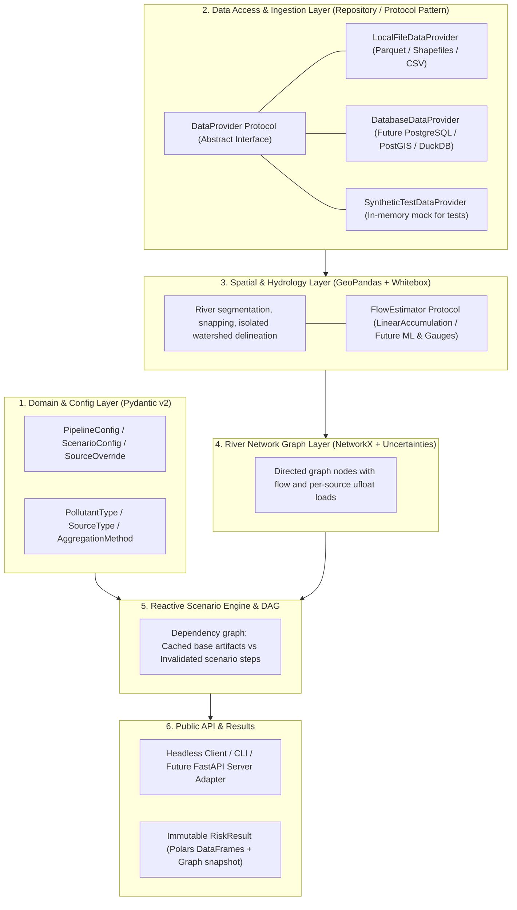

# Risk-Map Target Architecture Specification

**Status**: Proposal / Target Architecture  
**Branch**: `refactor`  
**Distribution Name**: `risk-map`  
**Package Target**: `src/risk_map/`

---

## 1. Executive Summary & Core Motivations

The `risk-map` modeling framework calculates point-source and diffuse water quality risks across river networks in the UK (EPSG:27700). The existing codebase ([RiskMap.py](RiskMap.py), [utils/](utils/)) suffers from several architectural and computational limitations:

1. **Stringly-Typed & Unsafe Interfaces**: Pollutants, sources, and aggregation methods are unvalidated strings (`"P"`, `"NH4"`, `"flow_avg"`), leading to silent logical failures and lack of autocompletion.
2. **Global Mutable State & Side Effects**: Catchment delineation writes to a fixed directory (`data/wbe`), and source modules ([utils/urbanRisk.py](utils/urbanRisk.py)) share global cache variables, preventing concurrent executions or clean server deployments.
3. **Quadratic & Redundant Graph Traversals**: Point sources are evaluated via $S$ independent Breadth-First Searches ($O(S \times V)$), causing execution times to scale poorly with number of outfalls ($S$).
4. **Physical Inconsistency Between Point and Diffuse**: Diffuse sources accumulate mass flux ($\text{g/s}$) topologically, while point sources propagate downstream concentrations through heuristic flow weighting.
5. **No Built-in Uncertainty**: All loads, flows, and degradation coefficients are deterministic point estimates with no variance or confidence tracking.
6. **No Reactive Scenario Support**: Disabling a single CSO requires re-evaluating the entire pipeline or manually hacking the NetworkX node attributes.

### Target Vision
A **typed, headless, modular, and reactive library** with:
- **Pydantic v2 + Strict Enums** for all domain models, configs, and serialization.
- **Hybrid Data Processing**: Polars for columnar lookups/joins; GeoPandas + Shapely 2 for spatial geometric predicates.
- **Unified 1D Advection-Decay Topological Sweep**: Propagates both point and diffuse loads in a single $O(V + E)$ pass while retaining **100% granular per-source attribution** at every river reach.
- **Native First-Order Error Propagation**: Integration with `uncertainties.ufloat` / `unumpy` across flows, loads, and risk ratios.
- **Reactive Scenario DAG**: Cached immutable intermediate artifacts (DEM, catchments, snapped rivers) allowing sub-second scenario evaluations (e.g. toggling a CSO outfall).

---

## 2. High-Level Architecture & Layered Design



---

## 3. Package Structure (`src/risk_map`)

```text
src/
└── risk_map/
    ├── __init__.py
    ├── config/
    │   ├── __init__.py
    │   ├── enums.py            # PollutantType, SourceType, AggregationMethod
    │   ├── models.py           # PipelineConfig, ScenarioConfig, SourceOverride
    │   └── constants.py        # Pollutant physical constants & degradation rates
    ├── data/
    │   ├── __init__.py
    │   ├── protocols.py        # DataProvider protocol (swappable repository interface)
    │   ├── local.py            # Local file-based provider (Parquet, CSV, Geopackage)
    │   ├── database.py         # Future external DB provider (PostGIS / SQL)
    │   └── synthetic.py        # Lightweight in-memory provider for fast unit tests
    ├── spatial/
    │   ├── __init__.py
    │   ├── flow.py             # FlowEstimator protocol (LinearFlowEstimator, GaugedFlowEstimator)
    │   ├── rivers.py           # Splitting and snapping (GeoPandas + Shapely 2)
    │   └── catchment.py        # Whitebox delineation with isolated scratch directories
    ├── models/
    │   ├── __init__.py
    │   ├── point_sources.py    # CSO and WwTW load calculators with uncertainties
    │   └── diffuse_sources.py  # Agriculture, livestock, urban loads with uncertainties
    ├── graph/
    │   ├── __init__.py
    │   ├── network.py          # NetworkX river graph construction
    │   └── propagation.py      # Single-pass topological sweep with source attribution
    ├── pipeline/
    │   ├── __init__.py
    │   ├── dag.py              # Lightweight dependency graph & cache manager
    │   ├── runner.py           # Headless executor
    │   └── results.py          # Immutable RiskResult object (Polars + GeoPandas)
    └── api/
        ├── __init__.py
        └── client.py           # High-level clean facade for users and notebooks
```

---

---

## 4. Subsystem Documentation

Detailed architectural specifications, mathematical formulations, and usage contracts are broken down per package layer:

- **Configuration, Enums & Physical Parameters**: [refactor/02-config.md](refactor/02-config.md)  
  Documents [src/risk_map/config/enums.py](src/risk_map/config/enums.py), [src/risk_map/config/models.py](src/risk_map/config/models.py), and [src/risk_map/config/constants.py](src/risk_map/config/constants.py).
- **Uncertainty & Measurement Model**: [refactor/03-uncertainty.md](refactor/03-uncertainty.md)  
  Documents error propagation, decay equations, and safe zero-flow handling in [src/risk_map/models/uncertainty.py](src/risk_map/models/uncertainty.py).
- **Spatial Hydrology & River Geometry**: [refactor/04-spatial.md](refactor/04-spatial.md)  
  Documents the `FlowEstimator` protocol and vectorized reach snapping in [src/risk_map/spatial/flow.py](src/risk_map/spatial/flow.py) and [src/risk_map/spatial/rivers.py](src/risk_map/spatial/rivers.py).
- **River Network Graph & Topological Sweep**: [refactor/05-graph.md](refactor/05-graph.md)  
  Documents primal graph construction, single-pass mass transport, and source attribution in [src/risk_map/graph/network.py](src/risk_map/graph/network.py) and [src/risk_map/graph/propagation.py](src/risk_map/graph/propagation.py).

---

## 5. Migration & Verification Strategy (TDD & Quality Gates)

Every change must pass our unified quality pipeline:
1. **Ruff Linting**: `ruff check src/ tests/` (imports, bugs, PEP 8 rules).
2. **Ruff Formatting**: `ruff format --check src/ tests/` (standardized formatting, quote style, indentation).
3. **Static Type Checking (`ty`)**: `ty check src/` and `ty check tests/` (sound AST type inference, zero type violations).
4. **Unit Test Suite (`pytest`)**: `pytest tests/unit/` (fast synthetic unit tests running in $< 0.5$ s).
5. **Characterization Tests (Golden Master)**: `pytest -m legacy` (verifying full outputs against the legacy golden baseline in [tests/fixtures/browney/golden_riskmap.parquet](tests/fixtures/browney/golden_riskmap.parquet)).

A convenience script is provided at [scripts/check.sh](scripts/check.sh) to run all quality gates in one command, and is automatically enforced via the pre-commit git hook.
