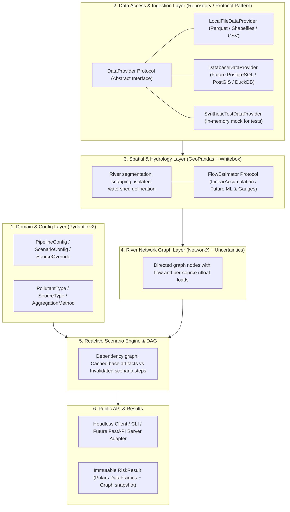

# Risk-Map Target Architecture Specification

**Status**: Proposal / Target Architecture  
**Branch**: `refactor`  
**Distribution Name**: `risk-map`  
**Package Target**: `src/risk_map/`

---

## 1. Executive Summary & Core Motivations

The `risk-map` modeling framework calculates point-source and diffuse water quality risks across river networks in the UK (EPSG:27700). The existing codebase ([RiskMap.py](../RiskMap.py), [utils/](../utils/)) suffers from several architectural and computational limitations:

1. **Stringly-Typed & Unsafe Interfaces**: Pollutants, sources, and aggregation methods are unvalidated strings (`"P"`, `"NH4"`, `"flow_avg"`), leading to silent logical failures and lack of autocompletion.
2. **Global Mutable State & Side Effects**: Catchment delineation writes to a fixed directory (`data/wbe`), and source modules ([utils/urbanRisk.py](../utils/urbanRisk.py)) share global cache variables, preventing concurrent executions or clean server deployments.
3. **Quadratic & Redundant Graph Traversals**: Point sources are evaluated via $S$ independent Breadth-First Searches ($O(S \times V)$), causing execution times to scale poorly with number of outfalls ($S$).
4. **Physical Inconsistency Between Point and Diffuse**: Diffuse sources accumulate mass flux ($\text{g/s}$) topologically, while point sources propagate downstream concentrations through heuristic flow weighting.
5. **No Built-in Uncertainty**: All loads, flows, and degradation coefficients are deterministic point estimates with no variance or confidence tracking.
6. **No Reactive Scenario Support**: Disabling a single CSO requires re-evaluating the entire pipeline or manually hacking the NetworkX node attributes.

### Target Vision
A **typed, headless, modular, and reactive library** with:
- **Pydantic v2 + Strict Enums** for all domain models, configs, and serialization.
- **Hybrid Data Processing**: Polars for columnar lookups/joins; GeoPandas + Shapely 2 for spatial geometric predicates.
- **Unified 1D Advection-Decay Topological Sweep**: Orders the network once while retaining per-source attribution. Arithmetic and output size still scale with the source contributions carried downstream; a single traversal is not a source-independent complexity guarantee.
- **Native First-Order Error Propagation**: Integration with `uncertainties.ufloat` / `unumpy` across flows, loads, and risk ratios.
- **Reactive Scenario DAG (proposed)**: Reuse intermediate artifacts when scenario changes do not affect them. Runtime and memory targets require representative benchmarks rather than an assumed sub-second guarantee.

---

## 2. High-Level Architecture & Layered Design



---

## 3. Package Structure (`src/risk_map`)

The tree below is a **target**, not a list of completed or approved modules.
Current implementation and detailed contracts are inventoried here:

| Files | Current responsibility and public entry points | Status / contract guide |
|---|---|---|
| `__init__.py` | Package version only; no top-level run API | Implemented |
| `config/{enums,models,constants}.py` | Vocabulary, `PipelineConfig`, `PollutantParameters`, shared defaults | Implemented; [configuration](02-config.md) |
| `models/uncertainty.py` | `Measurement`, coercion, scalar decay/dilution/risk | Implemented; [uncertainty](03-uncertainty.md) |
| `spatial/{flow,rivers}.py` | Estimator protocol, segmentation, snapping | Implemented; [spatial](04-spatial.md) |
| `spatial/{catchment,grouping}.py` | Whitebox workspace isolation, minimum-area grouping | Provisional implementation; [spatial](04-spatial.md); pour-point identity unresolved |
| `graph/{network,propagation}.py` | Graph construction, per-pollutant source propagation, mutable `ReachResult` | Implemented with topology limitations; [graph](05-graph.md) |
| `data/`, source models, `pipeline/`, `api/` | Providers, load preparation, lazy/scenario execution, public runner/results | Proposed; no implemented contract yet |

Subpackages re-export their main public helpers; `InjectedLoads` and
`MeasurementLike` are defined in their implementation modules. No end-to-end
headless facade currently assembles these helpers. Implemented dependency
direction is config -> scalar uncertainty / spatial helpers -> graph; the graph
builder depends on the spatial `FlowEstimator` protocol. Spatial package imports
also import the catchment dependencies. The future library/API boundary does not
yet imply optional or isolated hydrology imports.

```text
src/
└── risk_map/
    ├── __init__.py
    ├── config/
    │   ├── __init__.py
    │   ├── enums.py            # PollutantType, SourceType, AggregationMethod
    │   ├── models.py           # PipelineConfig, ScenarioConfig, SourceOverride
    │   └── constants.py        # Pollutant physical constants & degradation rates
    ├── data/
    │   ├── __init__.py
    │   ├── protocols.py        # DataProvider protocol (swappable repository interface)
    │   ├── local.py            # Local file-based provider (Parquet, CSV, Geopackage)
    │   ├── database.py         # Future external DB provider (PostGIS / SQL)
    │   └── synthetic.py        # Lightweight in-memory provider for fast unit tests
    ├── spatial/
    │   ├── __init__.py
    │   ├── flow.py             # FlowEstimator protocol (LinearFlowEstimator, GaugedFlowEstimator)
    │   ├── rivers.py           # Splitting and snapping (GeoPandas + Shapely 2)
    │   └── catchment.py        # Whitebox delineation with isolated scratch directories
    ├── models/
    │   ├── __init__.py
    │   ├── point_sources.py    # CSO and WwTW load calculators with uncertainties
    │   └── diffuse_sources.py  # Agriculture, livestock, urban loads with uncertainties
    ├── graph/
    │   ├── __init__.py
    │   ├── network.py          # NetworkX river graph construction
    │   └── propagation.py      # Single-pass topological sweep with source attribution
    ├── pipeline/
    │   ├── __init__.py
    │   ├── dag.py              # Lightweight dependency graph & cache manager
    │   ├── runner.py           # Headless executor
    │   └── results.py          # Immutable RiskResult object (Polars + GeoPandas)
    └── api/
        ├── __init__.py
        └── client.py           # High-level clean facade for users and notebooks
```

---

---

## 4. Subsystem Documentation

Detailed architectural specifications, mathematical formulations, and usage contracts are broken down per package layer:

- **Configuration, Enums & Physical Parameters**: [refactor/02-config.md](02-config.md)
  Documents [src/risk_map/config/enums.py](../src/risk_map/config/enums.py), [src/risk_map/config/models.py](../src/risk_map/config/models.py), and [src/risk_map/config/constants.py](../src/risk_map/config/constants.py).
- **Uncertainty & Measurement Model**: [refactor/03-uncertainty.md](03-uncertainty.md)
  Documents error propagation, decay equations, and safe zero-flow handling in [src/risk_map/models/uncertainty.py](../src/risk_map/models/uncertainty.py).
- **Spatial Hydrology & River Geometry**: [refactor/04-spatial.md](04-spatial.md)
  Documents the `FlowEstimator` protocol and vectorized reach snapping in [src/risk_map/spatial/flow.py](../src/risk_map/spatial/flow.py) and [src/risk_map/spatial/rivers.py](../src/risk_map/spatial/rivers.py).
- **River Network Graph & Topological Sweep**: [refactor/05-graph.md](05-graph.md)
  Documents primal graph construction, single-pass mass transport, and source attribution in [src/risk_map/graph/network.py](../src/risk_map/graph/network.py) and [src/risk_map/graph/propagation.py](../src/risk_map/graph/propagation.py).

---

## 5. Migration & Verification Strategy (TDD & Quality Gates)

### 5.1 Design Agreement Before Implementation

For each subsystem, follow **document -> agree -> test -> implement**. Work in
small, reviewable steps and pause for user review at the design and test
checkpoints. Existing code and tests are evidence of current behavior, not
automatic approval of a target contract. Do not rewrite existing modules merely
to match a proposed directory tree.

1. **Document the structure and responsibilities.** Update the package map above
   and the relevant subsystem document before changing production code. Identify
   which files own each responsibility, allowed dependency directions, public
   import paths, and private implementation details. Mark each part as existing,
   proposed, agreed, or deferred; proposed files are not a scaffolding checklist.
2. **Specify the public contracts and assumptions.** For each public function,
   class, or protocol, document its typed signature and a short caller example.
   Describe input/output schemas, identifiers, units, CRS, validation, exceptions,
   mutation and ownership, side effects, and deterministic behavior. Explicitly
   mark unresolved decisions rather than silently choosing defaults.
3. **Review and agree.** Explain the trade-offs and resolve contract questions
   with the user before encoding them in acceptance tests. Agreement applies to
   the reviewed subsystem, not to every proposal elsewhere in this document.
4. **Write and review tests first.** Map each agreed contract and assumption to
   a test or a stated verification limitation. Reuse existing tests where they
   already express the contract. For new behavior, run the focused tests and
   confirm they fail for the expected missing behavior before implementation.
   Existing passing characterization tests remain a baseline, not a red phase.
5. **Implement the smallest agreed slice.** Make the focused tests pass, then
   refactor while keeping them green and run the applicable quality gates below.
   If implementation reveals a contract problem, return to documentation and
   review before changing the expected results.

### 5.2 Contract Review Checklist

Use a compact table in each subsystem document with columns for **API/file**,
**contract or assumption**, **status**, **verification/test**, and **open question**.
Cover these architecture-wide concerns where relevant:

- **Data and spatial boundaries:** Polars versus GeoPandas/Shapely ownership,
  eager versus lazy evaluation, geometry representation, stable identifiers,
  units and conversions, missing data, and invalid or unmatched geometries.
- **Transport and attribution:** graph direction, cycles, disconnected reaches,
  junctions and flow splitting, source injection positions, decay units, dry or
  zero-flow behavior, and attribution down to individual sources, including the
  agreed granularity of diffuse sources. Separate numerical optimizations from
  scientific methodology changes; neither is assumed equivalent without tests.
- **Uncertainty:** meaning of nominal values, standard deviations and variances,
  shared uncertain inputs and correlations, first-order approximation limits,
  and whether table conversions preserve sufficient information for subsequent
  propagation. Marginal variances alone do not preserve covariance.
- **Scenarios and lazy execution:** what triggers computation, artifact ownership,
  cache keys and dependency invalidation, reuse across scenarios, source-level
  results, and how tests establish that unaffected work is not repeated.
- **Headless and future server use:** explicit inputs and outputs, no notebook
  dependencies or hidden global state, isolated work directories, failure
  behavior, and concurrency boundaries. No server implementation is required.
- **Performance and parallelism:** representative benchmark inputs, memory and
  attribution-output size, safe independent tasks, and sequential/parallel
  equivalence. One topological traversal does not make per-source arithmetic
  independent of source count; runtime targets require measurement.

### 5.3 Bounded Exploratory Work

When documentation or an analytical calculation cannot resolve a decision,
agree a small experiment: state the question, hypothesis, inputs, cheapest
discriminating check, and stopping condition first. Keep prototypes separate
from the production API and record the evidence and limitations in the relevant
subsystem document. An experiment may precede acceptance tests, but it does not
approve an API. Review the resulting contract, write its tests, and only then
promote the approach into production code.

### 5.4 Verification Layers and Migration

- **Legacy characterization:** freeze repeatable inputs, configuration, data
  versions, and intermediate/final results before replacing the corresponding
  legacy behavior. Baseline creation is explicit; tests must not silently
  regenerate their expected outputs.
- **Same-catchment equivalence:** run old and new paths on identical catchment
  inputs, align by stable identifiers rather than row order, and compare
  intermediate stages, per-source contributions, and final risks using documented
  tolerances. Record missing baseline data as a verification gap, not a pass.
- **Independent correctness:** use hand-checkable synthetic networks and geometry
  fixtures for mass balance, decay, attribution, uncertainty/correlation, edge
  cases, and scenario invalidation. Matching legacy output alone is not evidence
  of scientific correctness.
- **Intentional differences:** agree and document a bug fix or methodology change
  separately, including its expected numerical impact and regression tests.
  Never loosen tolerances simply to hide a mismatch.
- **Integration and performance:** test agreed boundaries together after their
  unit contracts pass; benchmark optimizations against a reproducible baseline
  without promising unmeasured millisecond runtimes.

For already implemented config, uncertainty, spatial, and graph components,
reconcile their subsystem documents, APIs, assumptions, and existing tests using
this process before extending them. For unimplemented data providers, source
models, pipeline/scenario execution, and result APIs, agree contracts first.
Result persistence and uncertainty estimation remain deferred; propagation and
in-memory intermediate reuse remain in scope.

### 5.5 Quality Gates

Applicable code changes must pass these checks; a documentation-only change
requires documentation checks, not execution of network-dependent hydrology:
1. **Ruff Linting**: `ruff check src/ tests/` (imports, bugs, PEP 8 rules).
2. **Ruff Formatting**: `ruff format --check src/ tests/` (standardized formatting, quote style, indentation).
3. **Static Type Checking (`ty`)**: `ty check src/` and `ty check tests/` (sound AST type inference, zero type violations).
4. **Unit Test Suite (`pytest`)**: `pytest tests/unit/` (synthetic and mocked tests; timing is environment-dependent).
5. **Legacy structure check**: `pytest -m legacy` currently checks the Browney
  golden fixture's row count, columns, and basic risk/flow sanity, not numerical
  equivalence with the refactored code. The fixture exists, but its test fixture
  regenerates it if missing and legacy imports can perform I/O. Explicit baseline
  capture and same-input legacy/new comparisons remain planned work.

The convenience script [scripts/check.sh](../scripts/check.sh) runs Ruff, Ty, and
unit tests via `.venv/bin`. It currently invokes Ty with `--fix`, so it is not a
read-only check, and it does not run legacy tests. Hook installation/enforcement
is not guaranteed by the script itself.
