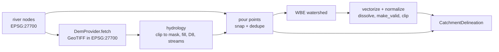

# Spatial Hydrology & River Geometry

This document covers the spatial discretization, point-source snapping, and flow estimation layer in [src/risk_map/spatial](../src/risk_map/spatial).

---

## 1. Design & Objectives

The spatial subsystem transforms raw vector datasets into a discretized mesh suitable for graph modeling:
- River lines are discretized into uniform segments bounded by a maximum target resolution.
- Discrete point sources (CSOs, WwTWs) are projected onto their nearest river line using spatial indexes.
- River discharge ($Q$) and flow velocity ($v$) are decoupled from configuration through an abstract protocol.

---

## 2. Module Reference

### Flow Estimation Strategy ([src/risk_map/spatial/flow.py](../src/risk_map/spatial/flow.py))
- `FlowEstimator`: Protocol defining the interface for computing reach discharge and velocity:
  - `estimate_flow(rivers)`: Returns reach discharge in m³/s as a Polars Series.
  - `estimate_flow_speed(rivers)`: Returns reach flow velocity in m/s as a float or Polars Series.
- `LinearAccumulationFlowEstimator`: Baseline implementation estimating discharge from upstream accumulated river length:
  $$Q = \text{US\_Accum} \times \text{coeff}$$
  Can be replaced by gauge assimilation, Manning equation routing, or runoff models without modifying river network topology.

### River Discretization & Point Snapping ([src/risk_map/spatial/rivers.py](../src/risk_map/spatial/rivers.py))
- `split_rivers`: Cuts lines at along-river `resolution` intervals using Shapely's `substring`, preserving bends, direction, total path length, and link attributes. Bend vertices inside a segment do not become graph nodes.
- `snap_points_to_rivers`: Projects points onto their nearest river reach within a cutoff search distance:
  - Uses GeoPandas spatial nearest joins (`sjoin_nearest`) backed by C-level R-trees.
  - Uses vectorized Shapely 2.0 primitives (`shortest_line` and `get_point`) to compute perpendicular projection coordinates on the reach.
  - Avoids Python-level row iteration.
  - Assigns `river_index`, `snapped_point`, and `snap_distance` in metres.

### Catchment Delineation ([src/risk_map/spatial/catchment.py](../src/risk_map/spatial/catchment.py))

> **Status:** the target contract is in [Section 6](#6-agreed-catchment-delineation-contract).
> The bullets below describe the current provisional implementation.

- `delineate_catchments`: Retrieves or reuses elevation tiles, runs the WBE 2 hydrology workflow, and returns watershed polygons in the input risk-map CRS.
- Each call uses a unique temporary WBE workspace to avoid collisions between concurrent runs. Elevation tiles remain in the caller-provided tile cache.
- WBE 2's `raster_to_vector_polygons` tool requires an input raster path, so the watershed raster is written to the temporary workspace before conversion.
- `workspace_root` optionally selects the parent directory for temporary workspaces; when omitted, the system temporary directory is used.
- The existing application still calls the legacy adapter at [utils/catchment_delineation.py](../utils/catchment_delineation.py) until orchestration is migrated.

#### Pour-point coverage and identity
- In the Browney notebook run with Jenson snapping and a 1,000-cell stream threshold, 426 river nodes produced 420 WBE polygon labels. Five pairs of nodes snapped to duplicate stream cells, and one node was not moved by snapping.
- WBE therefore cannot be assumed to emit exactly one polygon per river node. The legacy positional `VALUE - 1` join tolerates missing labels as empty geometries, so the pipeline completes, but mapping rows without polygon IDs are later excluded from diffuse-load allocation.
- The refactor must keep separate identities for river nodes and unique snapped pour points. Multiple river nodes may reference one WBE watershed label; unsnapped nodes must be surfaced explicitly rather than silently treated as valid catchments.
- Grouping inputs and membership outputs must support one WBE polygon mapping to multiple river nodes. `group_subcatchments` (Section 7) groups pour points, so shared watersheds are counted once.

### Minimum-Area Grouping ([src/risk_map/spatial/grouping.py](../src/risk_map/spatial/grouping.py))
- `group_subcatchments`: Takes a `CatchmentDelineation` and a downstream-directed river graph, collapses nodes sharing a pour point, and merges undersized watersheds downstream into subcatchments of at least `min_area_m2`. Returns a frozen `SubcatchmentGrouping`. Full contract in Section 7.

---

## 3. Testing

- [tests/unit/test_flow.py](../tests/unit/test_flow.py): Validates protocol conformity, linear accumulation calculations, and Polars return types.
- [tests/unit/test_rivers.py](../tests/unit/test_rivers.py): Validates LineString segment length bounds, exact total length conservation, and point-to-river snapping across all reach indices.
- [tests/unit/test_catchment.py](../tests/unit/test_catchment.py): Validates isolated WBE workspaces and raster-path conversion without network or DEM dependencies.
- [tests/unit/test_catchment_grouping.py](../tests/unit/test_catchment_grouping.py): Validates downstream accumulation, confluences, outlet remainder, shared pour points, topology errors, input validation, weights, and the `SubcatchmentGrouping` model.

## 4. Implemented API Contracts

**Status:** current implementation. `risk_map.spatial` exports these functions plus
`CatchmentDelineation` and `SubcatchmentGrouping`; DEM providers come from `risk_map.data`.
`flow.py` owns discharge estimation, `rivers.py` owns segmentation/snapping,
`catchment.py` owns external hydrology execution, and `grouping.py` owns polygon
membership. No end-to-end adapter currently connects all four responsibilities.

```python
LinearAccumulationFlowEstimator(coeff: float = 1.476e-5,
                                accum_col: str = "US_Accum",
                                flow_speed: float = 0.77)
FlowEstimator.estimate_flow(rivers: gpd.GeoDataFrame) -> pl.Series
FlowEstimator.estimate_flow_speed(rivers: gpd.GeoDataFrame) -> float | pl.Series
split_rivers(rivers: gpd.GeoDataFrame,
             resolution: float = DEFAULT_CONFIG.river_resolution) -> gpd.GeoDataFrame
snap_points_to_rivers(points: gpd.GeoDataFrame, rivers: gpd.GeoDataFrame,
                      max_distance: float = DEFAULT_CONFIG.max_outfall_distance
                      ) -> gpd.GeoDataFrame
delineate_catchments(river_nodes: gpd.GeoDataFrame, dem_provider: DemProvider, *,
                     node_id_column: str = "node_id",
                     mask: gpd.GeoDataFrame | None = None,
                     buffer_m: float = 10_000.0,
                     stream_threshold_m2: float = 240_000.0,
                     snap_distance_m: float = 100.0,
                     workspace_root: Path | None = None) -> CatchmentDelineation
group_subcatchments(delineation: CatchmentDelineation, river_graph: nx.DiGraph, *,
                    min_area_m2: float = DEFAULT_CONFIG.min_catchment_area,
                    graph_node_id_attribute: str = "nodeID") -> SubcatchmentGrouping
```

For a caller with projected metre-coordinate rivers and outfall points:

```python
from risk_map.spatial import (
    LinearAccumulationFlowEstimator,
    snap_points_to_rivers,
    split_rivers,
)

estimator = LinearAccumulationFlowEstimator()
reaches = split_rivers(rivers, resolution=300.0)
flows = estimator.estimate_flow(reaches)
matches = snap_points_to_rivers(points, reaches, max_distance=700.0)
```

### Flow and River Geometry

- The runtime-checkable `FlowEstimator` protocol checks method presence, not
  numerical validity. Series must align positionally with input rows; the graph
  consumes their NumPy values rather than aligning by IDs. The baseline returns
  a `flow` Series and a constant scalar speed, without mutating its input.
- Missing accumulation column raises `KeyError`. Coefficient, accumulated length,
  and speed are not constrained to positive finite values. With accumulated
  length in metres, the flow coefficient has units m2/s.
- `split_rivers` copies input, explodes MultiLineStrings, repeats attributes per
  piece, retains CRS, and returns a reset row index. Non-line geometries raise
  `TypeError`; nonpositive resolution raises `ValueError`. It assumes the active
  geometry column is named `geometry`. CRS, empty lines, and finite values have
  no explicit validation contract here.
- **Agreed splitting contract:** for positive-length lines in metre coordinates,
  cuts follow distance along the original path. Pieces retain original vertices
  between cuts and their direction, each length is at most `resolution`, and
  summed length matches the input within floating-point tolerance. Short and
  exactly-resolution lines remain one piece; multipart lines are split per part.
  Graph nodes remain segment endpoints, not interior bend vertices. For ordinary
  open lines this retains the previous sampling boundaries and graph size.
  This intentionally differs from the legacy chord geometry and its shortened
  lengths, so corrected decay results need not equal the old curved-line output.
- `snap_points_to_rivers` requires compatible projected CRS coordinates in metres
  but does not validate or reproject them. Nonpositive distance raises
  `ValueError`. Both inputs are left unmodified.
- Snapping returns original point columns and active point geometry plus
  `river_index` (position in the supplied rivers, not its original index label),
  `snapped_point`, and `snap_distance`. Unmatched rows have missing match fields.
  The active geometry remains the original source location.
- Ties keep the first joined row, without a stable asset-ID tie-break. Duplicate
  point index labels are collapsed and results sorted by index. `snapped_point`
  is assigned from a default-index GeoSeries, so non-default point indexes risk
  label misalignment. Current tests exercise only a unique default RangeIndex.

### Delineation Inputs, Outputs and Side Effects

- Requires a nonempty frame with a CRS and geometry column named `geometry`, and
  positive buffer, stream threshold, and snap distance; failures raise
  `ValueError`. Point geometry types and finite thresholds are not validated.
- Reprojects pour points and elevation bounds to EPSG:4326. Buffer and snap
  distance use degrees, not SI metres; stream extraction threshold counts cells.
  Elevation zoom is fixed at 12. These are explicit exceptions to the SI policy.
- Calls elevatr and Whitebox Workflows 2, may access the network, creates the tile
  directory and optional workspace parent, and writes temporary rasters/shapefiles.
  Temporary files are cleaned on exit; downloaded tile cache files are retained.
  Unique workspaces do not establish thread/process safety of the shared tile cache
  or underlying libraries.
- Missing elevation raises `RuntimeError`; missing output CRS raises `ValueError`.
  Other dependency/I/O failures propagate. Output is the Whitebox polygon frame,
  reprojected to input CRS, not clipped, repaired, grouped, or joined to node IDs.
  Attribute labels come from Whitebox rather than a normalized package schema.
- The numeric Browney observations above are recorded exploratory evidence, not
  assertions enforced by the mocked unit test. Persistent pour-point identity and
  duplicate-cell membership still need an agreed integration contract.

### Grouping Inputs and Output Schemas

- Requires a projected CRS whose axes use metres, a node-ID column, a DAG with at
  most one successor per node, and unique graph node-ID attributes. Unknown polygon
  IDs, missing graph IDs, invalid topology, or nonpositive minimum area raise
  `ValueError`. Missing polygons contribute empty geometry. Multiple rows for one
  node ID are unioned; polygons shared between different node IDs are not deduplicated.
- Assumes non-overlapping watershed zones and valid polygon inputs. Overlap is not
  checked: decisions use summed input area, while output `area` uses union area,
  so overlap can invalidate minimum-area flags. Empty-graph behavior and null IDs
  have no agreed contract.
- Inputs are not intentionally mutated. Output frames are mutable and use the
  polygon input CRS. Merged rows contain `subcatchment_id`, `area` (m2),
  `below_minimum` (bool), and `geometry`. Membership rows contain
  `subcatchment_id`, `node_id`, and `allocation_weight` (dimensionless).
  Polars identifier dtypes are inferred from supplied IDs, not fixed by schema.
- Group IDs derive from the finalizing node ID. The nearest finalized upstream
  group is chosen by graph hops, with stringified group ID breaking ties, not by
  metres. Returned row order is not a persistent identity contract.
- Allocation weights are equal per member node, including nodes without polygons;
  they are not area- or reach-length-weighted. These are proposed model choices,
  not an established legacy-equivalent diffuse allocation method.
- A topological ordering is used once, but repeated member-list copying, geometry
  unions, and output construction mean overall runtime is not guaranteed linear.

## 5. Contract Evidence and Open Decisions

| API/file | Contract or assumption | Status | Verification/test | Open question |
|---|---|---|---|---|
| Flow estimator | Protocol shape, ordered Series, baseline values | Implemented | `test_flow.py` | Invalid values, missing column, uncertain hydrology |
| Splitting | Path-preserving cuts, attributes, direction, CRS, no extra bend nodes | Agreed | Discretization, bent-line, graph-size, and multipart tests in `test_rivers.py` | Empty geometries and CRS validation |
| Snapping | Index-zero matching and distance cutoff | Implemented | `test_snap_points_to_rivers_including_index_zero` | Non-default indexes, duplicate labels, ties, CRS validation |
| Delineation | Pour-point identity, dedupe, nodata fallback, gap check, mask clipping, metre units, workspace isolation | Implemented (§6) | `test_catchment.py`, `test_dem.py` (mocked WBE); `tests/integration/test_catchment_browney.py` | Grouping adaptation to `watersheds` + `membership` |
| Grouping | Pour-point collapse, downstream accumulation, outlet remainder, topology errors, equal weights | Implemented (§7) | `test_catchment_grouping.py`; Browney grouping integration test | Allocation policy beyond equal split |

## 6. Agreed Catchment Delineation Contract

**Status:** implemented in [data/dem.py](../src/risk_map/data/dem.py) and
[spatial/catchment.py](../src/risk_map/spatial/catchment.py); unit tests mock Whitebox,
and the Browney integration test runs real Whitebox on cached tiles.

### 6.1 Decisions

| Topic | Decision | Notes |
|---|---|---|
| Structure | Separate stages with a swappable `DemProvider` | Future API-backed DEM provider must not touch hydrology code |
| DEM hand-off | Provider writes a GeoTIFF to a caller-given path with a correct nodata value declared | WBE reads paths; reprojection fill values must not be treated as elevation |
| Units/CRS | Reproject DEM to EPSG:27700; buffer and snap distance in metres | Intentional methodology change vs legacy degrees |
| Pour-point identity | Package-assigned `pour_point_id`, never WBE row order | Replaces legacy `VALUE - 1` positional join |
| Duplicate snapped cells | Deduplicate pour points before WBE; several nodes may share one `pour_point_id` | Splitting load between sharing nodes is a grouping/allocation decision |
| Node without own pour point | Mapped to the watershed label at the node's own location (normally downstream) | Hydrologically where its local area drains; works for headwaters |
| Nulls/status | Every node has a `pour_point_id`; no status column | |
| Normalization | `make_valid` before and after dissolve by label, optional mask clip, all inside delineation | WBE polygon output contains invalid rings that break dissolve |
| Snapping method | Jenson snapping to DEM-derived streams; stream burning deferred | Burning blocked by a WBE 2.0.6 rasterization bug (6.7) |
| DEM clipping | `mask` stays optional; when given, the DEM is clipped to it before hydrology | Prevents snapping onto rivers outside the study catchment (6.7); without a mask this risk remains |
| Defaults | `stream_threshold_m2=240_000`, `snap_distance_m=100`, `buffer_m=10_000` | 240k and 480k gave near-identical results (6.7); 240k leaves fewer nodes off-stream. Buffer applies only without a mask (legacy 0.15° ≈ 10–17 km) |
| Module layout | `DemProvider` + providers in new `data/dem.py` (data layer); `spatial/catchment.py` is hydrology only and depends on the protocol | DEM retrieval is data access; general `DataProvider` contract decided separately |
| Node outside all watersheds | Raise `ValueError` listing the node IDs | No silent fallback |
| Empty watershed after clip | Keep the row with empty geometry and `area_m2 = 0` | Grouping merges it downstream |
| Stream threshold | Contributing area in m2, converted to cells internally | Independent of DEM resolution |
| Result container | Pydantic `BaseModel`, `frozen=True`, `arbitrary_types_allowed=True`; `model_validator` enforces 6.4 | Project convention; frozen prevents field reassignment, not in-place table edits |
| Verification | Legacy baseline first; real-WBE Browney test marked `integration`, excluded from `check.sh` | |
| Unit tests | Whitebox and elevatr are mocked in unit tests; real WBE runs only in the integration test | Replaces the existing mocked workspace test |
| Input CRS | `river_nodes` may use any CRS; it is reprojected to EPSG:27700. Output is always EPSG:27700 | |
| Whitebox boundary | WBE only runs hydrology (fill, D8, accumulation, streams, Jenson snap, raster-pour-point watershed). rasterio does DEM clipping, coordinate-to-cell mapping, the pour-point grid, polygonizing labels and label lookups | Avoids WBE conversion bugs (6.7) and makes these steps testable with mocked WBE; rasterio becomes an explicit dependency |
| Precision grid | Watershed vertices snapped to 0.01 m | Removes zero-area slivers |

### 6.2 Stages and ownership



### 6.3 Draft API

```python
class DemProvider(Protocol):
    def fetch(self, bounds: tuple[float, float, float, float], crs: CRS,
              output_path: Path) -> Path: ...

ElevatrDemProvider(tile_folder: Path, zoom: int = 12)   # current source
LocalDemProvider(path: Path)                             # fixtures / pre-downloaded

class CatchmentDelineation(BaseModel):
    model_config = ConfigDict(frozen=True, arbitrary_types_allowed=True)
    watersheds: gpd.GeoDataFrame   # pour_point_id, area_m2, geometry
    membership: pl.DataFrame       # node_id, pour_point_id

def delineate_catchments(
    river_nodes: gpd.GeoDataFrame, dem_provider: DemProvider, *,
    node_id_column: str = "node_id", mask: gpd.GeoDataFrame | None = None,
    buffer_m: float = 10_000.0, stream_threshold_m2: float = 240_000.0,
    snap_distance_m: float = 100.0, workspace_root: Path | None = None,
) -> CatchmentDelineation
```

### 6.4 Output invariants

- `watersheds`: one row per `pour_point_id`; valid Polygon/MultiPolygon in EPSG:27700
  (line or point parts left by `make_valid` are dropped); clipped to `mask` when given;
  `area_m2` is the area of the normalized geometry.
- `membership`: exactly one row per input node; `pour_point_id` non-null and present
  in `watersheds`.
- Watersheds do not overlap (within floating-point tolerance).
- No gaps: the union of watersheds has no interior hole larger than half a DEM cell;
  otherwise `delineate_catchments` raises `ValueError`. An individual watershed may
  have holes, because a nested upstream watershed on an internal tributary can be
  fully enclosed by its downstream neighbour; every such hole must be filled by other
  watersheds. Holes are never filled, as that would double-count nested areas.
- Vertices are snapped to a small precision grid during dissolve, removing zero-area
  slivers between neighbouring watersheds.

### 6.5 Open questions

- None for delineation; grouping is specified in Section 7.

### 6.6 Legacy baseline

Captured by [scripts/capture_legacy_catchments.py](../scripts/capture_legacy_catchments.py)
into `tests/fixtures/browney/legacy_catchments/` (explicit `--force` to overwrite;
`metadata.json` records parameters and package versions). Browney, 300 m resolution,
WBE 2.0.6:

| Quantity | Value |
|---|---|
| River nodes | 426 (`node_id == 0..425`) |
| WBE labels / rows | 421 / 421 (9 MultiPolygon) |
| Nodes without a label | 5: `23, 210, 242, 278, 359` |
| Merged legacy catchments | 355, total area 177.59 km2 |

Expected intentional differences: metre-based DEM and snapping, no silently
dropped nodes, one dissolved geometry per label, and identity by `pour_point_id`.
Agreed after the experiment (6.7): total area and nodes above about 5 km2 cumulative
area must agree with legacy within 50%, unless the next node downstream agrees (a
tributary credited one node apart, as at node 195); >50% cumulative-area differences
are accepted for headwater nodes below about 5 km2, where legacy and new pour points
can each sit off the DEM channel.

### 6.7 Snapping experiment (stream burning deferred)

- **Question:** does stream burning with OS river vectors place pour points on the
  correct branch more reliably than Jenson snapping to DEM-derived streams?
- **Outcome:** deferred. WBE 2.0.6 `rasterize_streams` writes rivers row-flipped
  relative to the base DEM (Browney: 1/426 nodes on a river cell, 415/426 after
  flipping rows), in both EPSG:4326 and EPSG:27700. `fill_burn` and `burn_streams`
  results (0.62 and 70 km2 vs about 178 km2 legacy) are consistent with the same
  defect. `vector_points_to_raster` is correctly oriented (426/426). Legacy never
  rasterized lines, so its polygons are unaffected.
- **Other WBE findings:** an elevatr EPSG:27700 GeoTIFF is north-up and matches
  GDAL, but declares nodata -9999 while reprojected corners contain -32768;
  WBE reports EPSG 0 and `set_crs_epsg` does not persist; `Raster.from_numpy`
  rasters must be written to disk before tool use.
- **Location:** `experiments/snapping_comparison.py`, outside the package.

#### Metre-based Jenson vs legacy baseline (Browney)

EPSG:27700 DEM at about 11 m, nodata declared as -32768, stream threshold 480,000 m2,
snap distance 100 m, deduplicated raster pour points. "Cumulative" is the sum of
distinct watershed areas over a node and all graph ancestors.

| Quantity | Legacy | New, full buffered DEM | New, DEM clipped to mask |
|---|---|---|---|
| Total watershed area | 178.9 km2 | 652.3 km2 | 180.8 km2 |
| Area outside mask | 0.7% | 72.6% | 0.05% |
| Pour points / nodes sharing one | 421 labels, 5 nodes without | 418 / 16 | 418 / 16 |
| Nodes off DEM stream network | n/a | 55 | 54 |
| Median cumulative-area ratio | n/a | 0.997 | 1.004 |
| Nodes with cumulative area off by >50% | n/a | 35 | 34 |

- On the full DEM, node 21 (near the outlet) snapped onto a larger river outside
  Browney and took 474 km2. Clipping the DEM to the mask removes this.
- Nodes above roughly 5 km2 cumulative area agree closely with legacy, except node 195
  (5.6 km2 legacy, 2.5 km2 new): about 3 km2 of tributary area is assigned to node 195
  in legacy but to its downstream neighbour 196 in the new run, where cumulative areas
  agree again (5.8 vs 5.3 km2). All other >50% differences are headwater nodes below
  about 5 km2, where either the legacy or the new pour point sits off the DEM channel.

Stream-threshold sensitivity on the clipped DEM:

| Threshold | Off-stream nodes | Nodes sharing a pour point | Median cumulative ratio | Cumulative >50% off |
|---|---|---|---|---|
| 240,000 m2 | 48 | 16 | 1.004 | 33 |
| 480,000 m2 | 54 | 16 | 1.004 | 34 |
| 960,000 m2 | 78 | 14 | 0.999 | 39 |

240k and 480k are nearly identical; 960k leaves more headwater nodes off-stream
with near-zero watersheds. The largest persistent difference is a chain of nodes
(264-274) along the north-east mask edge, about 0.8 km2 new vs 0.01-0.02 km2 legacy.

Geometry check on the clipped 240k run: 21 of 418 watersheds contain holes (45 holes,
0.115 km2), all filled by other watersheds; the union has no gap with measurable area
(only zero-area floating-point slivers along shared edges). `make_valid` left 14
watersheds as GeometryCollections with line parts, which normalization must drop.

## 7. Agreed Subcatchment Grouping Contract

**Status:** implemented in [spatial/grouping.py](../src/risk_map/spatial/grouping.py),
replacing `merge_subcatchments_by_area`. Unit tests: `test_catchment_grouping.py`;
Browney integration: 422 watersheds and 426 nodes give 360 subcatchments, none below
the minimum (smallest 21,913 m2), total area unchanged.

### 7.1 Purpose and decisions

Watersheds below a minimum area are treated as artifacts of inaccurate delineation
(subcatchments are not expected to be smaller than about 20,000 m2). Grouping merges
them downstream into physically plausible subcatchments, which become the land units
for diffuse loads; each subcatchment's load is then split among its river nodes.

| Topic | Decision | Notes |
|---|---|---|
| Grouping unit | Pour points: nodes sharing a pour point are combined into one vertex first | A shared watershed is counted once and its nodes always stay in one subcatchment |
| Merge rule | Accumulate area downstream until a group reaches `min_area_m2`; an outlet remainder joins the nearest finalized upstream group (graph hops, ties by smaller ID); a whole connected component below the minimum is kept and flagged `below_minimum` | Same as the replaced helper |
| Topology | Each combined vertex must have at most one downstream neighbour and the combined graph must be acyclic; otherwise `ValueError` listing the nodes | Browney: river graph and combined graph both satisfy this (3 shared pour points: nodes 177+189, 278+279, 359+372+378) |
| Allocation | Equal split: `allocation_weight = 1 / member node count` | Legacy behaviour |
| Subcatchment ID | `pour_point_id` of the group's most downstream vertex | Traceable to the delineation |
| Minimum area | `DEFAULT_CONFIG.min_catchment_area` (20,000 m2) | |
| Input | A `CatchmentDelineation` plus the downstream-directed river graph | |
| Output | Pydantic `SubcatchmentGrouping`, frozen, validated | Project convention |

### 7.2 Draft API

```python
class SubcatchmentGrouping(BaseModel):
    model_config = ConfigDict(frozen=True, arbitrary_types_allowed=True)
    subcatchments: gpd.GeoDataFrame  # subcatchment_id, area_m2, below_minimum, geometry
    membership: pl.DataFrame         # subcatchment_id, node_id, allocation_weight

def group_subcatchments(
    delineation: CatchmentDelineation,
    river_graph: nx.DiGraph,
    *,
    min_area_m2: float = DEFAULT_CONFIG.min_catchment_area,
    graph_node_id_attribute: str = "nodeID",
) -> SubcatchmentGrouping
```

### 7.3 Invariants

- `subcatchments`: one row per `subcatchment_id`, EPSG:27700; geometry is the union of
  member watersheds (already on the 0.01 m grid from delineation, not re-snapped);
  `area_m2` is that union's area.
- `membership`: exactly one row per river node; every `subcatchment_id` exists in
  `subcatchments`; weights are positive and sum to 1 per subcatchment.
- Nodes sharing a `pour_point_id` always have the same `subcatchment_id`.
- Every graph node appears in the delineation membership and vice versa; otherwise
  `ValueError`. Nonpositive `min_area_m2`, missing or duplicate graph node IDs, and a
  watershed referenced by no river node also raise `ValueError`.
